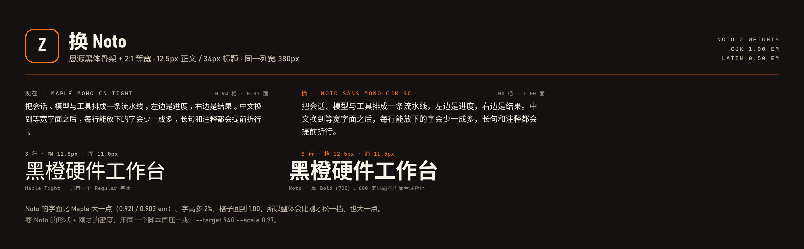
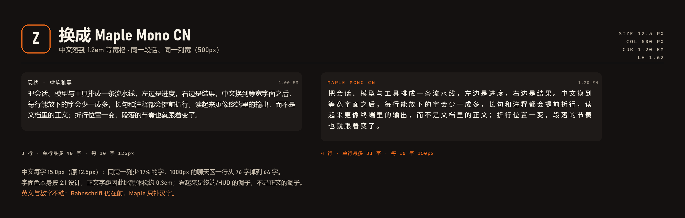
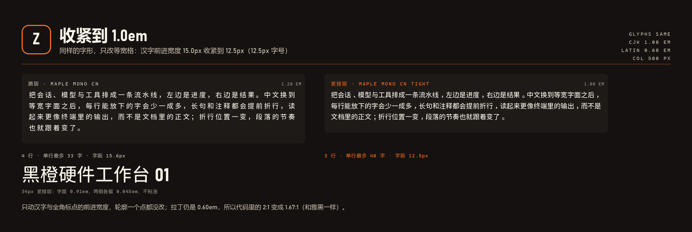

# ZONE 中文候选字体 · 样张与字库

为 ZONE skin 挑中文字体用的工作区。英文与数字**不动**（Bahnschrift / Cascadia Mono），
只给 `FONT_SANS` 的中文回退位找替换者。

> **当前（2026-10-24 晚）：中文走 `Noto Sans Mono CJK SC`**（思源黑体骨架，CJK 1.00em / 拉丁 0.50em，
> Regular + Bold 两个字重，真 Bold 让 600 的标题不再是合成粗体）。`FONT_SANS` 与 `FONT_MONO` 的中文位
> 只有两个：`Noto Sans Mono CJK SC` → `Microsoft YaHei`。英文与数字仍是 Bahnschrift / Cascadia Mono。
>
> **字体不随插件打包**（两个字重 31.8 MB，比整个插件大两个数量级）。换机器时先跑一次：
>
> ```powershell
> powershell -ExecutionPolicy Bypass -File font-lab\install-fonts.ps1
> ```
>
> 或者双击 `fonts/` 里那两个 `.otf`。装完重启一次应用（渲染进程只在启动时枚举字体）。
> 不装也能用，中文直接退到微软雅黑，字宽与样张对不上。
>
> Maple 已从回退链里摘掉（保留了这段历史）：之前那一版是 **Maple Mono CN Tight**，
> 把 1.2em 的全角格子改写成 0.94em、轮廓缩到 97%（`tools/tight-maple.py`）。
> 本机仍装着它，但皮肤不再引用。







## 结论先说

| 位置 | 推荐 | 理由 |
| --- | --- | --- |
| 正文 / UI（11–14px） | **HarmonyOS Sans SC** | 结构最接近 DIN：方中带圆、字面略窄，12–13px 深底上不糊；本机已装，零配置 |
| 想更"重"的标题 | **MiSans** | 34px/700 黑度 32.5%，比鸿蒙（29.0%）更接近雅黑现在的分量 |
| 想更"硬"的工业感 | **阿里巴巴普惠体 3.0** | 转折更方、笔直，粗字重像面板丝印；9px 处偏细 |
| 只进贴纸 / hero | **得意黑** | 斜切紧缩（约 0.77em 字宽），正文不可用 |
| 保留现状 | 微软雅黑 | 端点圆、字面宽，和 Bahnschrift 打架 |

推荐组合：**鸿蒙黑体做正文 + Bahnschrift 做英文/数字 + 得意黑只出现在 sticker 的中文上**。

## 文件

| 路径 | 用途 |
| --- | --- |
| `out/zone-cn-overview.png` | 五行并排总览（34px 标题 / 13px 正文 / 混排行 / 判词） |
| `out/zone-cn-context.png` | 界面内实测：侧栏、气泡、输入框、设备条 |
| `out/zone-cn-detail.png` | 六个常用字 56px 放大对照 + 实测数据 |
| `out/zone-mono-specimen.png` | 等宽对照：代码注释列 / 9px 标签 / 字宽比 |
| `out/zone-maple-after.png` | 改前 / 改后：同一段话在 500px 列里的换行差异 |
| `out/zone-maple-tight.png` | 1.2em 原版 vs 1.0em 紧排版，含 34px 大字检查 |
| `fonts/` | 可安装的字族：三个中文黑体 + 三个中文等宽 + 得意黑 + **Maple Mono CN Tight** |

## Maple Mono CN Tight 是怎么来的

`tools/tight-maple.py` 只改全角字（21248 个，advance 1200 → 1000）和全角标点，
按墨迹重新居中，轮廓一个点都不动；唯一一个墨迹宽 1020 的 `emdash.cv98` 横向压了 2%。
族名改成 `Maple Mono CN Tight`，可以和原版并存。

```sh
python tools/tight-maple.py            # 只报告墨迹分布
python tools/tight-maple.py --write    # 生成 font-lab/fonts/MapleMonoCNTight-Regular.ttf
```

代价：代码块里的中文不再是 2:1，而是 1.67:1（与雅黑相同）。正文密度回到正常，
这是这次要换的东西。

## 实测数据（`tools/measure-ink.py`）

- **中文都是整字宽 1em**：同一句 29 字，13px 下四个字族都是 377px，换字不会引起换行差异。
  得意黑约 0.77em（290px），会明显变窄。
- **13px 黑度**（墨迹覆盖率）：雅黑 16.4% / 鸿蒙 15.4% / MiSans 15.8% / 普惠 15.6%。
- **34px/700 黑度**：雅黑 34.7% / MiSans 32.5% / 鸿蒙 29.0% / 普惠 28.2%。
  → 换字体后标题会**变轻**，雅黑的 Bold 比这三家的 700 都黑。

## 等宽（中文）：华为与腾讯都没有

- **鸿蒙**：`HarmonyOS Sans` 家族只有 Sans / Serif / 多语言版本，没有等宽字族。它宣传的是
  **等宽数字**（tabular figures）——0–9 在 hmtx 里同宽，这多半就是"等距"的印象来源。
- **腾讯体**：腾讯的品牌字体，不是开源字体，下载站的授权说明是"除腾讯外均不得使用"，也不是等宽。

真正存在的免费中文等宽，我拉下来量过了：

| 字体 | 授权 | 拉丁 / 中文 | 对齐 |
| --- | --- | --- | --- |
| 更纱黑体 Sarasa Mono SC | OFL | 0.500 / 1.000 em | 2.00 列 ✅ |
| Maple Mono CN | OFL | 0.600 / 1.200 em | 2.00 列 ✅ |
| Noto Sans Mono CJK SC | OFL | 0.500 / 1.000 em | 2.00 列 ✅ |
| Cascadia Mono（现状） | MIT | 0.586 em，无中文 | 回退雅黑 1.0 em → **1.71 列**，COL 46 处偏 −20 px |

结论：设备条里只有"ZONE 橙"这一两个汉字，差 0.3 列肉眼看不出；**痛点只在代码块的中文注释**。
换的话必须整条 `FONT_MONO` 一起换——Cascadia 的拉丁是 0.586 em，Sarasa 是 0.5 em，
只把 Sarasa 垫在 Cascadia 后面当中文回退，仍然是 1.71 列。

顺手：Bahnschrift 的数字是**比例数字**（1 = 681、4 = 1165 / 2048），设备条和贴纸上的数值一变宽
就会跳；它带 `tnum` 特性，给这些数字加 `font-variant-numeric: tabular-nums` 即可定宽。

## 授权

均为免费商用：HarmonyOS Sans（华为）、MiSans（小米）、阿里巴巴普惠体 3.0（阿里）、
得意黑（SIL OFL 1.1）、Sarasa / Maple / Noto（SIL OFL 1.1）。
分发完整字库前仍建议在自己的发布物里附上各自授权声明。

## 落地：改一行

`package/client.js` 第 35 行，把中文回退插到 `"Microsoft YaHei"` **之前**：

```js
const FONT_SANS = 'Bahnschrift, "Segoe UI Variable Text", "Segoe UI", "HarmonyOS Sans SC", "Microsoft YaHei UI", "Microsoft YaHei", system-ui, sans-serif';
```

只换贴纸位的中文（`--zone-display`，第 499 行）：

```css
--zone-display: Bahnschrift, "Segoe UI Variable Display", "Segoe UI", "Smiley Sans Oblique", "HarmonyOS Sans SC", "Microsoft YaHei", sans-serif;
```

注意：`--zone-display` 现在只服务 `.zone-sticker-mark`，中文几乎不落进去；真要贴纸上的中文用得意黑，
得在 `.zone-sticker-mark` 上单独写 `font-family`，别动全局。

如果决定换等宽（第 33 行）：

```js
const FONT_MONO = '"Sarasa Mono SC", "Maple Mono CN", "Cascadia Mono", "Cascadia Code", Consolas, "Microsoft YaHei", ui-monospace, monospace';
```

## 复现

```sh
python tools/render-specimen.py   # 重出四张样张（PIL + 真实字体文件）
python tools/measure-ink.py       # 复测黑度与字宽
python tools/measure-mono.py      # 复测等宽字体的字宽比
```

本机没有可用的无头浏览器（沙箱禁止命名管道），所以样张是用 PIL 直接排版渲染的，
不是网页截图；尺寸与 `client.js` 里的数值一一对应。
